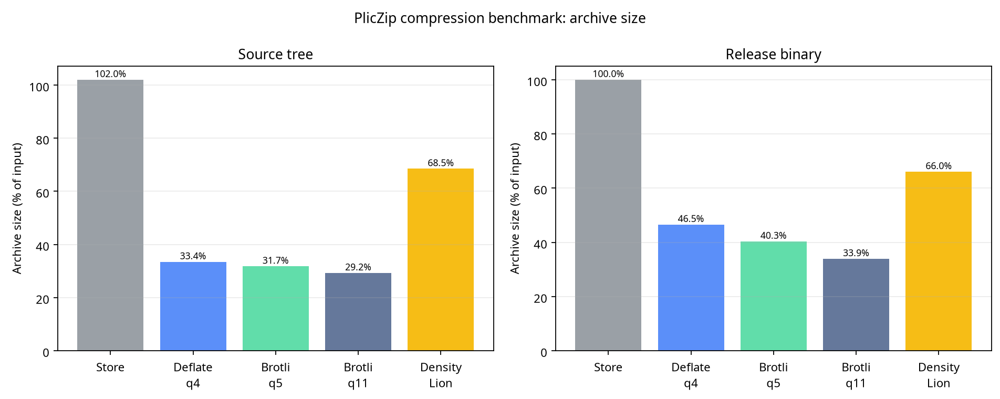

# Benchmark Density против алгоритмов PlicZip

Дата прогона: 2026-11-22. Версия бинарника: `pliczip 1.26.103`. Повторений на каждую комбинацию: **3**. Среда: AMD EPYC, 6 vCPU, KVM.

## Методика

Сравнивались пять режимов, доступных в PlicZip: Store (`--level 0`), Deflate (`--level 4`), Brotli q5 (`--level 5`), Brotli q11 (`--level 11`) и Density/Lion (`--density --level 5`). Измерялось полное время CLI-команды создания и распаковки `.plz`; startup процесса входит в измерение. Размер — фактический размер готового `.plz`, включая индекс и служебные данные.

Использованы реальные данные из текущего репозитория: tracked source tree размером **927.5 KiB** и release-бинарник `pliczip` размером **7.86 MiB**. После каждой распаковки выполнялась проверка SHA-256 дерева файлов. Все **30 операций** завершились успешно.

## Source tree

| Метод | Архив | От исходного | Экономия | Упаковка, MiB/s | Распаковка, MiB/s |
|---|---:|---:|---:|---:|---:|
| Store | 946.1 KiB | 102.0% | -2.0% | 131.5 | 66.6 |
| Deflate q4 | 310.0 KiB | 33.4% | 66.6% | 72.5 | 69.9 |
| Brotli q5 | 294.4 KiB | 31.7% | 68.3% | 45.9 | 42.5 |
| Brotli q11 | 271.2 KiB | 29.2% | 70.8% | 1.8 | 38.6 |
| Density (Lion) | 635.3 KiB | 68.5% | 31.5% | 10.4 | 61.6 |

Для source tree Density дал архив **2.16× больше**, чем Brotli q5, и **2.34× больше**, чем Brotli q11. При этом распаковка Density была примерно в **1.45× быстрее** Brotli q5. На небольших разнородных файлах Density не показал преимущества по времени упаковки: его средняя скорость составила **10.4 MiB/s** против **45.9 MiB/s** у Brotli q5.

## Release binary

| Метод | Архив | От исходного | Экономия | Упаковка, MiB/s | Распаковка, MiB/s |
|---|---:|---:|---:|---:|---:|
| Store | 7.86 MiB | 100.0% | -0.0% | 323.1 | 905.0 |
| Deflate q4 | 3.66 MiB | 46.5% | 53.5% | 73.5 | 281.8 |
| Brotli q5 | 3.17 MiB | 40.3% | 59.7% | 27.9 | 169.2 |
| Brotli q11 | 2.66 MiB | 33.9% | 66.1% | 0.7 | 162.8 |
| Density (Lion) | 5.19 MiB | 66.0% | 34.0% | 174.0 | 236.7 |

На release-бинарнике Density упаковывал примерно в **6.2× быстрее** Brotli q5 и в **241× быстрее** Brotli q11. Цена — размер: архив Density был в **1.64× больше** Brotli q5 и в **1.95× больше** Brotli q11.

По распаковке Density также оказался быстрее Brotli: **236.7 MiB/s** против **169.2 MiB/s** у Brotli q5 и **162.8 MiB/s** у Brotli q11.

## Вывод

Density в текущей реализации — это режим **быстрого создания и быстрой распаковки**, а не максимальной экономии места. На одном release-бинарнике он существенно быстрее Brotli q5/q11, но уступает им по размеру архива. На source tree с большим количеством небольших файлов преимущество по упаковке не проявилось, а отставание по степени сжатия стало ещё заметнее.

Практическая рекомендация: использовать Density для быстрых промежуточных архивов, CI/artifact-пакетов и сценариев, где важнее время доступа. Для долгосрочного хранения и минимального размера выбирать Brotli q5 или Brotli q11; Brotli q11 особенно дорог по времени упаковки.

## Файлы результатов

- `results.csv` — плоская таблица результатов.
- `results.json` — полные данные, включая времена всех повторов и хеши входов.
- `density-comparison.png` — график относительного размера архивов.
