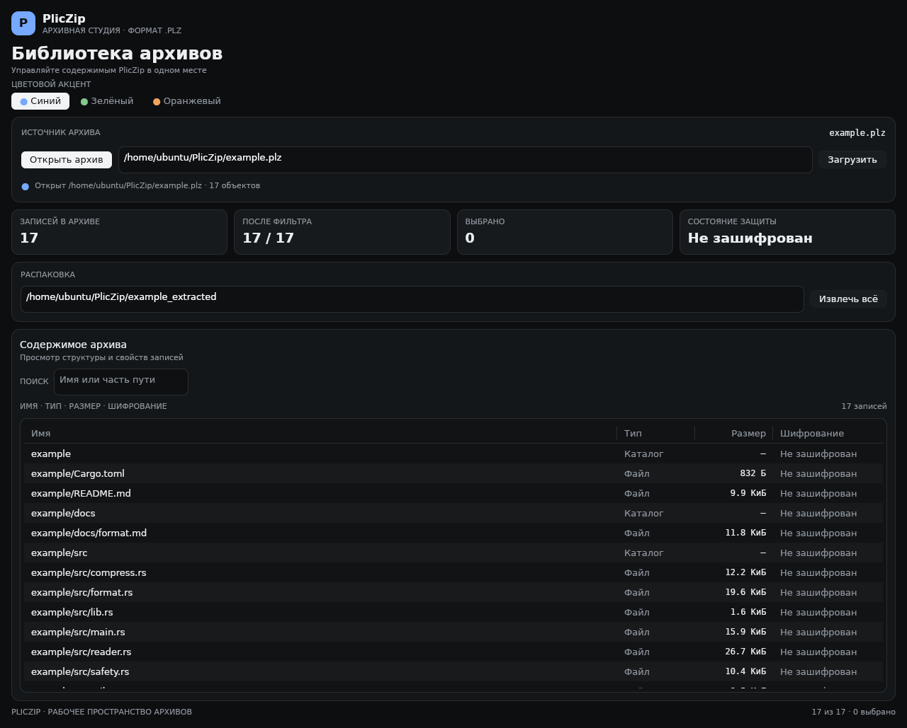

# PlicZip v1.26.109-rune-beta

## Русский

Экспериментальный pre-release с продолжением редизайна Rune GUI.

- Основной интерфейс переведён на русский язык; шрифт **Intro** встроен в приложение и поддерживает кириллицу.
- Обновлены компактная адаптивная компоновка, верхняя строка бренда и состояния «архив не открыт», «архив пуст», «ничего не найдено» и ошибка.
- Подпись защиты «Не зашифрован» отображается явно; архивная таблица сохраняет просмотр, сортировку и мультивыбор, а загрузка и распаковка всего незашифрованного `.plz` остаются доступны.
- Поля ввода получили доступные названия; минимальный размер окна — 700 × 760.

Rune GUI остаётся экспериментальным. Создание архивов, выборочное извлечение и ввод пароля пока не перенесены; зашифрованные архивы не открываются. Для обычной работы используйте стабильный релиз `v1.26.106`.

## English

Experimental pre-release continuing the Rune GUI redesign.

- The interface is localized in Russian; the **Intro** font is embedded and supports Cyrillic.
- The compact responsive layout, top brand row, and distinct “archive not open”, “empty archive”, “no results”, and error states are refined.
- The “Not encrypted” status is explicit. Archive browsing, sorting, multi-selection, opening, and whole-archive extraction for unencrypted `.plz` files remain available.
- Input fields have accessible names; the minimum window size is 700 × 760.

Rune GUI remains experimental. Archive creation, selective extraction, and password entry have not yet been ported; encrypted archives cannot be opened. For normal use, please use the stable `v1.26.106` release.
