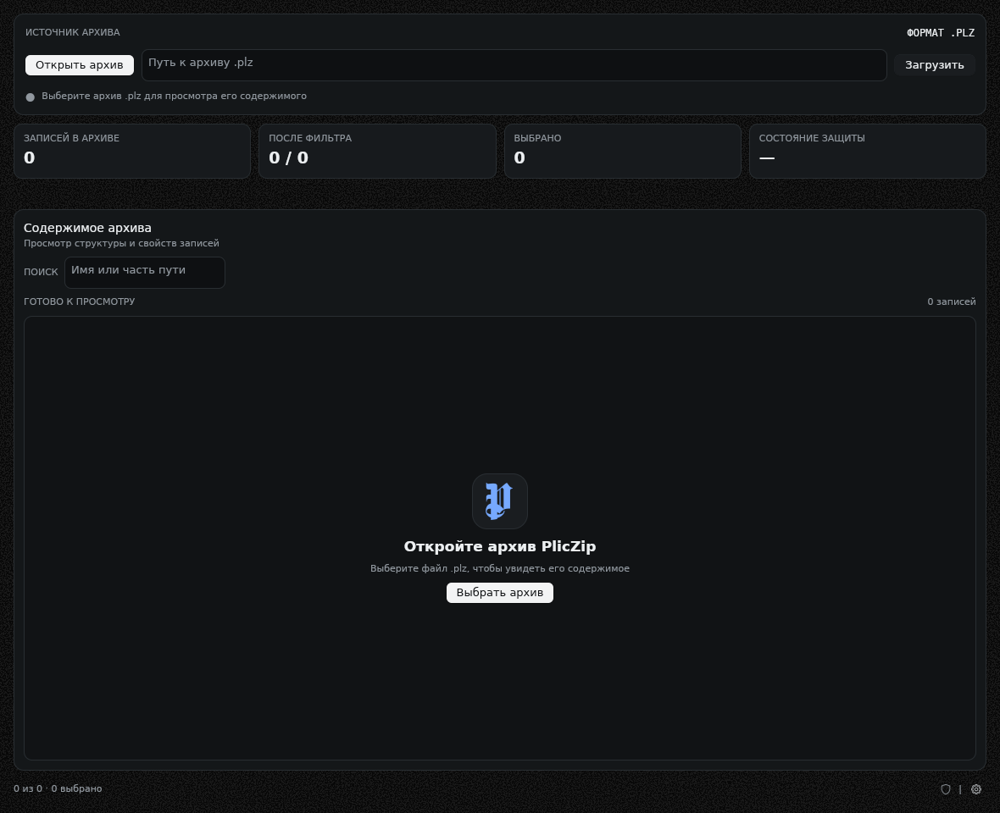
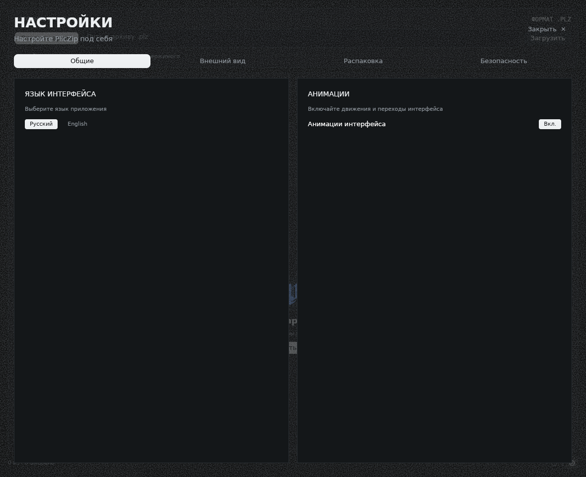

# PlicZip v1.26.110-rune-beta

## Русский

Экспериментальный pre-release с полноэкранными настройками Rune GUI.

- Настройки растянуты на всё окно; удалена голубая рамка и скругления, сохранено затемнение основного интерфейса.
- Добавлен зернистый фон настроек, адаптированный к выбранной теме.
- Верхняя навигация переключает разделы «Общие», «Внешний вид», «Распаковка» и «Безопасность».
- В разделах доступны выбор языка, темы и акцентного цвета, анимации, папка назначения и ручная/автоматическая проверка BLAKE3.
- Обновлён README Rune preview и добавлен актуальный скриншот настроек.

Rune GUI остаётся экспериментальным: создание архивов, выборочное извлечение, ввод пароля и открытие зашифрованных архивов пока не перенесены. Настройки Rune GUI не сохраняются после закрытия. Для повседневной работы используйте стабильный релиз `v1.26.106`.

## English

Experimental pre-release featuring full-window settings for the Rune GUI.

- Settings now span the entire window; the cyan outline and rounded corners are removed while the main interface remains dimmed behind the screen.
- Added a grain-textured settings background that follows the selected theme.
- Top navigation switches between General, Appearance, Extraction, and Security.
- The sections expose language, theme and accent selection, animation controls, extraction destination, and manual/automatic BLAKE3 verification.
- Updated the Rune preview README and added a current settings screenshot.

Rune GUI remains experimental: archive creation, selective extraction, password entry, and encrypted archive opening have not yet been ported. Rune settings are not persisted across restarts. For everyday use, please use the stable `v1.26.106` release.
